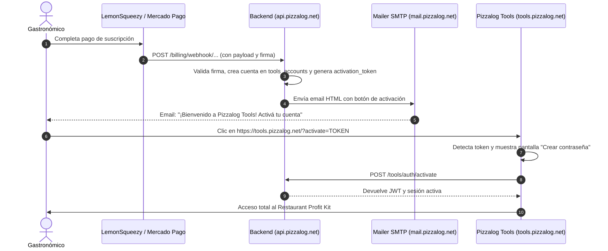

# 🚀 Guía Definitiva de Lanzamiento Comercial — Pizzalog Tools

Esta guía detalla todos los pasos operativos, técnicos y comerciales para comenzar a vender **Pizzalog Tools (Restaurant Profit Kit)** a nivel nacional (Argentina / Latam) e internacional.

---

## 1. Arquitectura de Despliegue y Subdominios

| Componente | URL de Producción | Directorio en Servidor (Ferozo) | Función |
| :--- | :--- | :--- | :--- |
| **Pizzalog Tools (SPA)** | `https://tools.pizzalog.net` | `/public_html/tools` (o subdominio apuntado a `tools/`) | Suite de costeo, masas panaderas, matriz BCG y simulador. |
| **API Backend** | `https://api.pizzalog.net` | `/public_html/backend` (apuntado a `backend/public/`) | Autenticación, webhooks de cobro, sincronización y workspaces. |
| **Pizzalog App / Panel** | `https://app.pizzalog.net` | `/public_html/app` | Panel TPV y administración de pedidos y cartas. |
| **La Carta Digital** | `https://pizzalog.net/{slug}`| `/public_html/` | Menú interactivo público para clientes finales. |

---

## 2. Configuración Segura del Servidor (`config.local.php`)

Tu archivo `backend/config/config.local.php` vive exclusivamente en tu servidor (está ignorado por Git y nunca se expone en repositorios). 

Asegurate de que contenga los siguientes bloques para habilitar pagos y envíos de correo:

```php
<?php
// backend/config/config.local.php
return [
    'debug' => false,

    'db' => [
        'host'    => 'localhost',
        'name'    => 'a0140456_app',
        'user'    => 'a0140456_app',
        'pass'    => 'TU_PASSWORD_REAL_DE_FEROZO',
        'charset' => 'utf8mb4',
    ],

    'jwt' => [
        'secret' => 'CLAVE_SECRETA_LARGA_DE_64_CARACTERES',
        'issuer' => 'pizzalog',
        'ttl'    => 28800, // 8 horas
    ],

    // Servidor de correo de tu hosting de Ferozo
    'smtp' => [
        'host'       => 'mail.pizzalog.net',
        'port'       => 465,                      // Puerto seguro SSL
        'username'   => 'no-reply@pizzalog.net',   // Casilla creada en Ferozo
        'password'   => 'PASSWORD_DEL_BUZON',
        'from_email' => 'no-reply@pizzalog.net',
        'from_name'  => 'Pizzalog Tools',
    ],

    // Pasarela Internacional: LemonSqueezy
    'lemonsqueezy' => [
        'webhook_secret' => 'TU_WEBHOOK_SIGNING_SECRET_DE_LEMONSQUEEZY',
    ],

    // Pasarela Argentina / Latam: Mercado Pago
    'mercadopago' => [
        'access_token'   => 'APP_USR-TU_ACCESS_TOKEN_DE_MERCADOPAGO',
        'webhook_secret' => 'TU_WEBHOOK_SECRET_OPCIONAL',
    ],

    'tools' => [
        'url' => 'https://tools.pizzalog.net',
    ],

    'cors' => [
        'allowed_origins' => [
            'https://tools.pizzalog.net',
            'https://staging.pizzalog.net',
            'https://app.pizzalog.net',
            'https://pizzalog.net',
        ],
    ],
];
```

---

## 3. Configuración de Pasarelas de Cobro

### A. LemonSqueezy (Ventas al Exterior en USD)

1. **Crear Producto y Variantes:**
   - Ingresá a tu panel de LemonSqueezy $\to$ **Store** $\to$ **Products** $\to$ **New Product**.
   - Nombre: `Pizzalog Tools — Restaurant Profit Kit`.
   - Tipo: **Subscription**.
   - Creá 2 variantes:
     - **Plan Mensual:** `$19.00 USD / mes`.
     - **Plan Anual:** `$190.00 USD / año` (incluye 2 meses de bonificación).
   - Copiá el enlace de checkout de cada variante (ej. `https://pizzalog.lemonsqueezy.com/buy/UUID-VARIANTE-MENSUAL`).

2. **Configurar el Webhook:**
   - En LemonSqueezy andá a **Settings** $\to$ **Webhooks** $\to$ **Add Webhook**.
   - **Callback URL:**
     ```
     https://api.pizzalog.net/billing/webhook/lemonsqueezy
     ```
   - **Signing Secret:** Creá una clave alfanumérica y pegala en `config.local.php` en `'lemonsqueezy' => ['webhook_secret' => '...']`.
   - **Events to send:**
     - `subscription_created`
     - `subscription_payment_success`
     - `subscription_updated`
     - `subscription_cancelled`
     - `subscription_expired`

---

### B. Mercado Pago (Ventas en Argentina / Latam en ARS)

1. **Crear Plan de Suscripción o Link de Pago:**
   - En Mercado Pago Developers / Panel de Suscripciones, creá un plan de cobro recurrente mensual y anual en pesos argentinos (ARS).
   - Obtené el link de suscripción directa o el `preapproval_plan_id`.

2. **Configurar Webhook / Notificaciones IPN:**
   - En tu panel de Mercado Pago Developers $\to$ **Tus integraciones** $\to$ **Webhooks**.
   - **URL de producción:**
     ```
     https://api.pizzalog.net/billing/webhook/mercadopago
     ```
   - **Eventos:** `subscription_preapproval`, `payments`.

---

### C. Personalización de Enlaces en el Frontend sin Recompilar

Podes crear un archivo `tools/config.js` en tu servidor (o editarlo vía FTP) con tus links reales y teléfono de WhatsApp:

```javascript
// tools/config.js (opcional en el servidor)
window.__PIZZALOG_TOOLS_CONFIG__ = {
  lemonSqueezyMonthlyUrl: "https://pizzalog.lemonsqueezy.com/buy/TU_VARIANTE_MENSUAL",
  lemonSqueezyYearlyUrl: "https://pizzalog.lemonsqueezy.com/buy/TU_VARIANTE_ANUAL",
  mercadoPagoMonthlyUrl: "https://www.mercadopago.com.ar/subscriptions/checkout?preapproval_plan_id=TU_PLAN_MENSUAL",
  mercadoPagoYearlyUrl: "https://www.mercadopago.com.ar/subscriptions/checkout?preapproval_plan_id=TU_PLAN_ANUAL",
  whatsappPhone: "54911XXXXXXXX", // Tu WhatsApp real de atención
  supportEmail: "soporte@pizzalog.net"
};
```

---

## 4. El Ciclo de Vida del Cliente Post-Pago



---

## 5. Captación de Clientes y Modo Demo en Vivo (CRO)

Para maximizar la conversión de visitantes a suscriptores:

1. **Explorar Demo sin Registro:**
   En la pantalla de acceso de `tools.pizzalog.net`, cualquier interesado puede hacer clic en **«🚀 Explorar Demo en Vivo (Sin Registro)»**. 
   Esto le abre instantáneamente la pizzería de ejemplo *«Il Forno»* para que pueda:
   - Probar cómo se calculan las masas con Biga o Poolish y el porcentaje panadero.
   - Ajustar los deslizadores del **Simulador de Rentabilidad** y ver el Punto de Equilibrio en tiempo real.
   - Filtrar los cuadrantes de la **Matriz Kasavana-Smith (Ingeniería de Menú)**.
   - Probar el **Actualizador Rápido de Precios con Listas de Proveedores**.

2. **Garantía Incondicional de 7 Días:**
   Se comunica explícitamente en el checkout y en el modal de planes que el cliente puede solicitar el 100% de reintegro dentro de los primeros 7 días si el software no se ajusta a su pizzería.

3. **Copia de Seguridad y Portabilidad Absoluta:**
   El usuario puede descargar en cualquier momento una copia completa en `.json` o su propio archivo Excel `.xlsx`, garantizándole que sus fórmulas y recetas son siempre de su propiedad.
